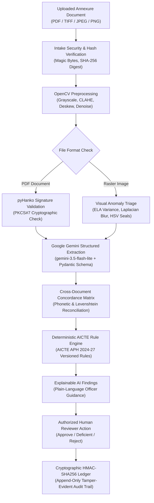

# ARC-Verify — AI-Powered Application Validation, Document Authentication & Regulatory Compliance Verification

[](https://www.sih.gov.in/)
[](https://www.aicte-india.org/)
[](https://ai.google.dev/)
[](https://nextjs.org/)
[](https://fastapi.tiangolo.com/)
[-brightgreen.svg)]()
[]()

> **Core Philosophy:** *AI extracts and highlights evidence; deterministic rules evaluate statutory requirements; immutable cryptographic ledgers enforce accountability; authorized human scrutiny officers make consequential decisions.*

---

## 1. Executive Summary & Problem Context

**ARC-Verify** is an enterprise-grade regulatory scrutiny, document authentication, and compliance verification platform engineered for the **All India Council for Technical Education (AICTE)** under **Smart India Hackathon 2026 (Problem Statement 26261)**.

Every year, AICTE scrutinizes tens of thousands of institutional applications for New Technical Institutions and annual Extensions of Approval (EoA). Manual scrutiny of complex multi-annexure dossiers—spanning land title deeds, conversion orders, municipal building plans, fire safety NOCs, faculty rosters, and bank FDR corpus funds—is labor-intensive, vulnerable to oversight, and prone to cross-document inconsistencies.

**ARC-Verify automates and secures this entire scrutiny pipeline:**
1. **Intelligent Document Intake:** Validates binary magic bytes, enforces file limits, computes SHA-256 digests, and executes real OpenCV image preprocessing (CLAHE contrast enhancement, deskewing, Gaussian denoising).
2. **Gemini Generative OCR & Extraction:** Employs **Google Gemini (`gemini-3.5-flash-lite`)** with strict **Pydantic schemas** to extract structured regulatory evidence with confidence scores and exact textual provenance.
3. **Cross-Document Concordance Engine:** Reconciles institutional names, trust titles, land survey/khasra numbers, and financial extents across disparate legal instruments using phonetic algorithms and Levenshtein similarity.
4. **Deterministic Rule Engine:** Evaluates statutory norms from the **AICTE Approval Process Handbook (APH 2024–27)** across Land, Built-up Area, FSR, Fire NOCs, and Affiliations with 6 discrete outcomes (`PASS`, `FAIL`, `WARNING`, `INCONCLUSIVE`, `NOT_APPLICABLE`, `NOT_CHECKED`).
5. **Floating AI Help Chat Co-Pilot:** Provides human scrutiny officers and applicants with an interactive in-app assistant grounded strictly in AICTE statutory regulations.
6. **Tamper-Evident HMAC-SHA256 Audit Ledger:** Cryptographically chains every upload, extraction, rule evaluation, and reviewer decision into an immutable audit trail with live integrity monitoring.

---

## 2. System Architecture

```
                                  +---------------------------------------+
                                  |         Institutional Users           |
                                  |   (Officers, Auditors, Admins, etc.)  |
                                  +-------------------+-------------------+
                                                      |
                                                      | HTTPS / WSS
                                                      v
                                  +---------------------------------------+
                                  |          Next.js 16 Web App           |
                                  |    (App Router, React 19, Tailwind)   |
                                  |  - Authenticated Layout & App Chrome  |
                                  |  - Floating Gemini AI Help Chat Widget|
                                  |  - Cryptographic Audit Ledger View    |
                                  |  - Concordance & Findings Scrutiny    |
                                  +---------+-------------------+---------+
                                            |                   |
                           Signed Sessions  |                   | Forward Document
                           & Case Metadata  |                   | Intake & Chat
                                            v                   v
+---------------------------------------+       +---------------------------------------+
|        Local Data & Persistence       |       |       FastAPI Document AI Service     |
|  - SQLite (WAL mode, transactions)    |       |  - Document Processing Pipeline       |
|  - Chained HMAC-SHA256 Audit Ledger   |       |  - OpenCV Preprocessing (CLAHE, Deskew|
|  - Private Uploads Storage Directory  |       |  - PDF Cryptographic Sig (pyHanko)    |
|  - In-Memory Cache (SHA-256 keyed)    |       |  - Image Forensics (ELA, Blur, Seals) |
+---------------------------------------+       +-------------------+-------------------+
                                                                    |
                                                                    | Google GenAI SDK
                                                                    v
                                                +---------------------------------------+
                                                |     Google Gemini API (Cloud)         |
                                                |  - Model: gemini-3.5-flash-lite       |
                                                |  - Structured JSON Output & Pydantic  |
                                                |  - Grounded AICTE APH Scrutiny Chat   |
                                                +---------------------------------------+
```

---

## 3. End-to-End Scrutiny Workflow



---

## 4. Gemini Generative AI Capabilities

### 4.1 Floating AI Help Chat Co-Pilot (`AiHelpChat.tsx`)
Mounted globally across all authenticated routes in `app/(app)/layout.tsx`:
* **Context Awareness:** Automatically injects user role (`SCRUTINY_OFFICER`, `ADMIN`, `COMPLIANCE_AUDITOR`, `APPLICANT`) and active case ID (`/cases/[id]`).
* **Prompt Starters:** One-click shortcuts for complex statutory queries:
  * 🏛️ *What are the land requirements for Metro cities?*
  * 👥 *How is Faculty-to-Student Ratio (FSR) verified under APH?*
  * 🚒 *What are the mandatory statutory checks for Fire Safety NOC?*
  * 🔐 *Explain the HMAC-SHA256 audit ledger integrity status.*
  * 📑 *How do I resolve a cross-document name discrepancy?*
* **Structured Responses:** Rich markdown bubbles with actionable follow-up pill buttons and official citation footers (e.g., *AICTE APH 2024–27 Appendix 4*).
* **Session Resilience:** Preserves multi-turn conversation history during navigation via `sessionStorage`.

### 4.2 Structured Field Extraction with Pydantic (`extraction_schemas.py`)
Replaces fragile regex with type-safe structured JSON models:
* Extracts: Institution Legal Name, Trust/Society Name, Land Area (Acres/Sqm), Survey/Khasra Numbers, FDR Corpus (INR), Fire NOC Issue/Expiry Dates, Building Plan Approval Authority.
* Associates every field with:
  * `evidence`: Direct verbatim quote from the document text.
  * `status`: Explicitly distinguishes `extracted` from `not_found` or `inconclusive`.
  * `confidence`: Float between `0.0` and `1.0`.

### 4.3 Plain-Language Reviewer Explanations (`/findings/explain`)
Translates programmatic validation findings into neutral, clear executive summaries for scrutiny committees:
* Identifies evidence basis strictly from recorded finding parameters.
* Provides clear next steps (e.g. *"Issue a deficiency notice for expired Fire NOC"*, *"Verify land conversion certificate with district collector"*).
* Guardrailed to never invent legal penalties or unverified approvals.

### 4.4 Cross-Document Concordance Analysis (`/dossier/cross-document-analysis`)
Semantically compares declared application form inputs against OCR extractions:
* Classifies matches into `MATCH`, `FUZZY_WARNING` (minor typography), and `MISMATCH_SUSPECTED` (distinct legal entities).

---

## 5. Security & Application Hardening

ARC-Verify was audited and hardened against institutional application security standards:

| Security Vector | Risk Identified | Hardened Implementation |
|---|---|---|
| **Session Secrets** | Predictable hard-coded fallback secrets. | Enforced environment configuration with minimum 32-character high-entropy secret; server refuses to boot on weak secrets. |
| **Authentication** | Legacy/unsigned cookies used for identity spoofing. | Strictly verified HMAC-SHA256 signed session tokens; unsigned cookies ignored with HTTP 401. |
| **Credential Hygiene** | API routes exposing password hashes. | Salted `scrypt` hashing for all passwords; `sanitizeUser()` strips credentials from all responses. |
| **Session Revocation** | Tokens valid until expiration after logout. | Unique JTI tracking in SQLite session table; instant server-side revocation upon logout. |
| **Object-Level RBAC** | Unrestricted access across dossiers (TC-14). | Centralized `canAccessCase()` and `canReviewCase()` checks on every case API route. |
| **Audit Ledger Integrity** | Audit logs susceptible to client-side forgery or tampering. | Server-derived actor identity; cryptographically chained HMAC-SHA256 ledger with live health verification banner on `/audit`. |
| **File Upload Security** | Unbounded uploads, path traversal, shell execution. | 15 MB payload limit, binary magic byte checks (`%PDF-`, `FF D8 FF`, `89 50 4E 47`), SHA-256 verification, private UUID storage. |
| **Digital Signatures** | String searches for `/ByteRange` mistaken for validity. | Real PKCS#7 / CMS cryptographic signature validation via `pyHanko`; flags unsigned, altered, or self-signed certs. |
| **Forensics Guardrails** | Heuristic signals mistaken for proof of forgery. | Explicitly labeled as `EXPERIMENTAL_HEURISTIC_SIGNAL_ONLY`; flags route to human review and never auto-reject. |

---

## 6. Seeded Demo Accounts & Role Matrix

The platform is pre-seeded with standardized accounts for demonstration:

| Role | Email | Password | Access Scope |
|---|---|---|---|
| **Super Admin** | `superadmin@example.com` | `SuperAdmin@123` | Complete root access, system settings, user & role management, audit snapshots. |
| **Administrator** | `admin@example.com` | `Admin@123` | Operational management; case workflow routing, user administration. |
| **Scrutiny Officer** | `officer@example.com` | `Officer@123` | Case scrutiny, rule evaluation, concordance inspection, deficiency notice issuance. |
| **Compliance Auditor**| `auditor@example.com` | `Auditor@123` | Independent oversight; read-only access to dossiers, reports, and cryptographic audit hash chain. |
| **Applicant** | `operator@example.com` | `Operator@123` | Institutional applicant; upload application forms & annexures, track application status. |

---

## 7. Pre-Seeded Regulatory Demo Scenarios

| Scenario | Case ID | Profile | Key Demonstration Highlights | Expected Outcome |
| :--- | :--- | :--- | :--- | :--- |
| **Scenario A — Fully Compliant Dossier** | `CASE-2026-001` | `AICTE_NEW_INSTITUTION` | All 6 mandatory annexures attached; exact cross-document concordance; `SIGNATURE_VALID`; 3.2 Acres Urban (>=2.5 Ac norm); 11,800 sq.m built-up. | `READY_FOR_OFFICER_REVIEW` |
| **Scenario B — Deficient Dossier** | `CASE-2026-002` | `AICTE_NEW_INSTITUTION` | Missing Fire NOC & FDR; wrong catering invoice uploaded for Building Plan (`TC-03`); substantive name mismatch (`TC-05`); Rural land shortfall (4.8 < 7.5 Ac). | `NEEDS_INFORMATION` |
| **Scenario C — Inconclusive Authenticity** | `CASE-2026-003` | `AICTE_NEW_INSTITUTION` | Fuzzy spelling variance ("Ganga Vally", `TC-06`); ELA score 24.8 > 18.0 (`TC-11`); low sharpness 38.5 < 45.0 (`TC-04`); consumer PDF producer warning. | `REVIEW_REQUIRED` (Never auto-rejected) |
| **Scenario D — Annual EoA Renewal** | `CASE-2026-004` | `AICTE_EXTENSION_OF_APPROVAL` | Demonstrates profile-specific rules; marks initial land acquisition (`COMP-08`) as `NOT_APPLICABLE` (`TC-12`). | `READY_FOR_OFFICER_REVIEW` |

---

## 8. Quality & Test Automation Results

The repository is verified with automated tests covering both frontend and backend services:

```text
================================================================================
TEST SUITE EXECUTION SUMMARY
================================================================================

1. TypeScript Type Safety Check:
   Command: npx tsc --noEmit
   Result:  PASS (0 Errors, Code 0)

2. Next.js / TypeScript Automated Test Suite:
   Command: npm test
   Result:  39 passed, 0 failed, 0 skipped (100% Pass)
   Time:    19.98s
   Coverage:
     ✔ AI Help Chat API & Session Guards (4 tests)
     ✔ Scrypt Password Hashing & Sanitization (1 test)
     ✔ HMAC-SHA256 Signed Sessions & JTI Revocation (2 tests)
     ✔ Multipart Upload Security & Magic Bytes (1 test)
     ✔ Cross-User Case Access Control TC-14 (1 test)
     ✔ Rule Engine & AICTE APH Handbooks (2 tests)
     ✔ pyHanko PKCS#7 Cryptographic Digital Signatures (1 test)
     ✔ SQLite Persistence & Chain Survival (1 test)
     ✔ RBAC Permissions Matrix across 5 Roles (10 tests)
     ✔ Serverless OCR & Hindi/Regional Script Scans (5 tests)
     ✔ String & Phonetic Concordance Algorithms (5 tests)
     ✔ Individual AICTE Compliance Rules (5 tests)

3. Python Microservice Test Suite:
   Command: python -m pytest ai-service/tests
   Result:  15 passed, 0 failed, 0 skipped (100% Pass)
   Time:    143.08s
   Coverage:
     ✔ test_chat.py: Regulatory guidance, history persistence, schema validation (3 tests)
     ✔ test_document_pipeline.py: End-to-end PDF & image pipeline (2 tests)
     ✔ test_extraction.py: Pydantic schemas, evidence extraction, normalization (5 tests)
     ✔ test_gemini.py: Live Gemini 3.5 Flash Lite calls, caching, error recovery (5 tests)

4. Production Build:
   Command: npm run build (Turbopack)
   Result:  PASS (38 Static & Dynamic Routes Prerendered Successfully)
================================================================================
TOTAL TESTS: 54 PASSED, 0 FAILED (100% SUCCESS)
================================================================================
```

---

## 9. Local Installation & Development Setup

### Prerequisites
* **Node.js:** v20.x or higher
* **Python:** v3.11 or higher
* **Package Managers:** `npm` and `pip`

### Step 1: Clone Repository & Configure Environment
```bash
git clone https://github.com/gokullaxman/ARC-Verify.git
cd ARC-Verify

# Copy environment template
cp .env.example .env.local
```

Ensure `.env.local` has your Gemini API key and high-entropy session secret:
```env
ARC_VERIFY_SESSION_SECRET=arc_verify_super_secure_session_secret_key_minimum_32_characters_2026
ARC_VERIFY_AUDIT_KEY=arc_verify_audit_hmac_ledger_secret_key_si2026_ps26261
GEMINI_API_KEY=your_google_gemini_api_key_here
GEMINI_MODEL=gemini-3.5-flash-lite
```

### Step 2: Set Up Python AI Microservice
```bash
cd ai-service

# Create and activate virtual environment
python -m venv .venv

# Windows:
.\.venv\Scripts\Activate.ps1
# Linux / macOS:
source .venv/bin/activate

# Install dependencies
pip install -r requirements.txt

# Start FastAPI AI microservice
python -m uvicorn main:app --host 127.0.0.1 --port 8000 --reload
```

### Step 3: Set Up Next.js Frontend
In a new terminal:
```bash
# Install dependencies
npm ci

# Run test suites
npm test

# Start Next.js development server
npm run dev
```

Visit **`http://localhost:3000`** and log in with any demo account.

---

## 10. Production Deployment (Docker & Cloud Ready)

ARC-Verify is packaged for deployment using Docker and Docker Compose, compatible with national cloud providers such as **NIC MeghRaj**:

```bash
docker compose up -d --build
```

### Container Topology
* **`arc-verify-web` (Port 3000):** Optimized Next.js 16 container running in non-root user mode.
* **`arc-verify-ai` (Port 8000):** FastAPI container pre-configured with Tesseract OCR, OpenCV, pyHanko, and Google GenAI SDK.
* **`arc_verify_data` (Volume):** Persistent Docker volume mounting SQLite databases and encrypted private uploads.

---

## 11. Project Directory Structure

```
ARC-Verify/
├── ai-service/                   # FastAPI Document AI & Gemini Microservice
│   ├── document_pipeline.py      # End-to-end PDF/Image ingestion pipeline
│   ├── extraction_schemas.py     # Pydantic schemas for structured extraction & chat
│   ├── gemini_service.py         # Google GenAI SDK client, in-memory cache, retries
│   ├── preprocessing.py          # Real OpenCV transforms (CLAHE, deskew, blur)
│   ├── extract_pdf.py            # pyHanko PKCS#7 signature verification
│   ├── main.py                   # FastAPI application routes (/pipeline, /chat, etc.)
│   ├── requirements.txt          # Python microservice dependencies
│   └── tests/                    # Pytest test suite (15 tests)
├── app/                          # Next.js 16 App Router
│   ├── (app)/                    # Authenticated Route Group (App Chrome Layout)
│   │   ├── layout.tsx            # Global Layout with PageHeader & AiHelpChat
│   │   ├── dashboard/            # Executive scrutiny statistics
│   │   ├── cases/                # Dossier management & case review workbench
│   │   ├── cases/[id]/           # Scrutiny workbench, concordance matrix, findings
│   │   ├── audit/                # HMAC-SHA256 Cryptographic Audit Ledger
│   │   ├── rules/                # AICTE APH handbook rule configuration
│   │   ├── verification/         # Quick-verification runner
│   │   └── analytics/            # Institutional throughput analytics
│   ├── api/                      # Next.js Serverless API Routes
│   │   ├── auth/                 # Login, Logout, Session check
│   │   ├── cases/                # Case CRUD, document upload, rule analysis
│   │   ├── chat/                 # AI Help Chat proxy with RBAC & context injection
│   │   └── audit/                # Cryptographic audit ledger API
│   ├── login/                    # Public authentication portal
│   └── layout.tsx                # Root HTML layout with AuthProvider
├── components/                   # React 19 UI Components
│   ├── chat/                     # Floating AI Help Chat co-pilot
│   ├── layout/                   # Sidebar, Header, Breadcrumbs, PageContext
│   └── auth/                     # AccessDenied guard, AuthContext provider
├── domain/                       # Core regulatory domain entities & types
├── lib/                          # Cryptographic utilities, DB service, RBAC guards
├── repositories/                 # Dossier, Rule, and Audit SQLite data access
├── services/assurance/           # Compliance rule engine, Concordance builder
├── tests/                        # Next.js / TypeScript test suite (39 tests)
├── docs/                         # Deployment readiness report & specifications
├── docker-compose.yml            # Multi-container production deployment
├── Dockerfile                    # Next.js production container specification
└── package.json                  # Next.js project manifest & scripts
```

---

## 12. Regulatory Notice & Disclaimer

* **Decision Support System:** ARC-Verify is an explainable decision-support platform designed to assist statutory scrutiny officers. It does not replace the statutory authority of the All India Council for Technical Education (AICTE) or its Executive Committee.
* **Forensic Signals:** Optical seal detection, Laplacian sharpness indices, and Error Level Analysis (ELA) scores are preliminary heuristics that guide human review; they do not constitute legal proof of document authenticity or fraud.
* **External Integrations:** In environments where live government registry APIs (DigiLocker, State Land Revenue Portals, Bank CBS) are unconfigured, ARC-Verify gracefully marks integration rules as `NOT_CHECKED` (`SOURCE_UNAVAILABLE`) rather than assuming or fabricating compliance.

---

**Developed for Smart India Hackathon 2026 (Problem Statement 26261)**  
*AICTE Approval Scrutiny & Regulatory Verification Team*
